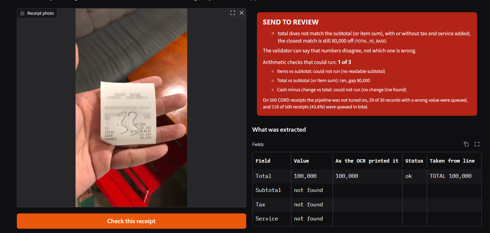

# Receipt Intelligence

**From a receipt photo to a structured record, and a flag on every record that cannot be trusted.**

A company gets receipts as photos and needs structured records, not retyping. OCR alone isn't enough, because one misread digit becomes a wrong number in the accountant's books. I built a pipeline that extracts the data and, more importantly, flags the records it can't trust. The flags come from arithmetic checks (items vs subtotal, subtotal + tax + service vs total, cash minus change vs total) that notice a plausible-looking wrong number.

On 500 CORD receipts that nothing was tuned on, the pipeline sent 29 of 30 wrong-value records to review. The price: 218 of the 500 receipts (43.6%) went to review, and this README says exactly what those 218 are made of.

**What is AI here:** the OCR (PaddleOCR) and an optional LLM extractor are pretrained models. Everything else (merging, repair, rule-based extraction, the validator, the scorer) is classic software and arithmetic. Nothing is trained in this project. The honest label is "applied AI and evaluation of a pipeline built on pretrained models".

**Benchmark:** CORD, a public dataset of Indonesian receipts. It is not Tunisian data, and I say so wherever it matters.

## Headline numbers

Pipeline: PaddleOCR, rule-based extractor, validator. Pool: CORD test (100) plus the first 400 receipts of CORD's train split ("holdout B", explained below). Counts, not percentages, wherever the pool is small.

| Question | Answer | What it does not tell you |
|---|---|---|
| Of the records with a wrong total, subtotal, tax or service value, how many reached the review queue? | **29 of 30** | Only 30 such records exist in the pool, so the true catch rate could be noticeably lower. One was missed (holdout B receipt 88, explained below). Items are not part of this count. |
| How many receipts went to review? | **218 of 500 (43.6%)** | The development set showed 30%; the unseen splits showed 52% (test) and 41.5% (holdout B).|
| What are the 218 made of? | **29** wrong-value records, **120** records where the extractor left a field empty, **69** records the four-field scorer calls clean | The 69 are "false alarms" only by that four-field definition. A breakdown for holdout B is in the validator section. |

The other side of the same numbers: 282 receipts were not queued, and 1 of them had a wrong value. Items are not checked by the validator's headline, and none of this was measured on non-CORD receipts.



*The demo on a CORD validation receipt (CORD is CC-BY-4.0). The OCR took 100,000, the cash amount, for the total, with confidence 0.99, because the amount column sits one row below its labels. The only item is 20,000, so the total is 80,000 off and the receipt is sent to review. The cash-minus-change check could not run on this receipt: no change amount was found.*

## Run the demo

Windows, Python 3.12, from the repo root. There are two environments because PaddleOCR is installed apart from everything else: the demo runs the OCR as a separate process, so a native crash inside Paddle cannot take the page down.

```powershell
python -m venv .venv
.\.venv\Scripts\python.exe -m pip install -r requirements.txt
python -m venv .venv-paddle
.\.venv-paddle\Scripts\python.exe -m pip install -r requirements-paddle.txt
.\.venv\Scripts\python.exe -m scripts.demo_app
```

Open the local address the demo prints. The four example buttons load saved OCR output and run every later stage live, so they answer instantly. A photo you upload goes through the real OCR, which took about 40 seconds on my 6 GB laptop. I wrote these commands from my two working environments and have not yet tested them on a fresh clone.

## Data and how I split it

**Dataset.** CORD, the Consolidated Receipt Dataset (Naver Clova), loaded from the Hugging Face dataset `naver-clova-ix/cord-v2`. License CC-BY-4.0. Citation: Park, S., Shin, S., Lee, B., Lee, J., Surh, J., Seo, M., Lee, H. "CORD: A Consolidated Receipt Dataset for Post-OCR Parsing", Workshop on Document Intelligence at NeurIPS 2019.

**What the labels contain.** Only the items, a subtotal block and a total block. There is no merchant and no date, so the pipeline extracts the total, subtotal, tax, service charge and the items. Amounts are read as rupiah (no decimals). The currency is configured per dataset, not detected.

**The three groups of receipts**

| Name in this README | What it is | How it was used |
|---|---|---|
| Development set | CORD validation, 100 receipts | All design and tuning. It is used up: I browsed it freely. |
| Test | CORD test, 100 receipts | Fixed in advance (the ids are fingerprinted in `data/test_ids.json`, and every script checks the fingerprint first). Settings were frozen, then run once. Counts only, never browsed. |
| Holdout B | The first 400 receipts of CORD's train split (indices 0-399) | Counted once before I looked at any receipt. Then 20 receipts, drawn with a fixed random seed, were looked at for error analysis only. No code changed afterwards. |

Holdout B is CORD's train split, but nothing in this project is trained and nothing was tuned on it. "Unseen" in this README means test plus holdout B (500 receipts): nothing was tuned on them.

**What was tuned on the development set.** The merge and repair constants (tuned on the first OCR engine's output, EasyOCR, and not retuned for Paddle), the extraction rules (versions 2 and 3), the LLM prompt (version 1 is frozen; one revision was rejected by a rule I wrote in advance), the validator's checks, its tolerance (1 rupiah) and the definition of the review queue. The validator checks were written after looking at development receipts, and the queue definition after seeing development numbers, so the development numbers are optimistic. Development used only 100 receipts even though the train split was available.

**How I call a record.** For each receipt I compare the extracted total, subtotal, tax and service with the label:
- **Wrong-value record:** one of those four fields holds a number that differs from the label.
- **Missing-field record:** the extractor left one of the label's fields empty. Nothing wrong was returned, but nothing was returned either.
- **Clean ("ok") record:** none of the above.

Items are not part of this definition. That matters later: some "clean" receipts that get queued do have a wrong item.

**Duplicates.** CORD contains the same paper photographed twice (two receipts in my error-analysis sample were one paper). I did not run a duplicate check across splits, so pooled counts treat every receipt as separate.

## The pipeline, walked through one receipt                        photo -> OCR -> merge -> repair -> extractor -> validator -> verdict
| | | | |
pieces rows, letters rules OR flags and a
+ boxes joined read for an LLM review queue
+ conf. numbers digits

scorer = evaluation only: compares the record to CORD?s label      
**1. OCR.** PaddleOCR (English PP-OCRv6, medium detector and recognizer, pretrained, running locally). It returns *pieces*, not lines: a piece of text, its box on the photo, and a confidence between 0 and 1.

**2. Merge.** Groups pieces into rows by their height on the page, and joins a number that the detector cut in two (only two-piece joins). Made-up example: the pieces `45,` and `500` become `45,500`.

**3. Repair.** Looks only at tokens that have the shape of an amount and fixes letters that were read in place of digits. Made-up example: `5O,OOO` becomes `50,000`. Each token gets a status: ok, repaired, review or not an amount.

**4. Extractor.** Two arms.
- *Rules arm:* takes the total only from a line that has a total keyword. There is deliberately no fallback to "the largest number", because that would return the cash row, with confidence. No total line means the field stays empty.
- *LLM arm:* a pretrained model (gpt-oss-120b on Groq) sees the merged and repaired text, never the image, and returns the fields plus an evidence line for each.

The demo runs the rules arm only.

**5. Validator.** The smoke alarm. It never sees the image, only the extracted record and the OCR text. It runs arithmetic checks, and a check that cannot run is reported as "could not run", never as a pass. Full explanation in the validator section.

**6. Scorer.** Only for evaluation: field-level precision and recall, item matching by price, exact match.

**Which stage fixes which error.** Detection can cut one number into pieces (merge fixes that). Recognition can read letters for zeros (repair fixes that). Recognition can also read a plausible wrong digit, and then only arithmetic can notice.

### One real receipt, start to finish

CORD validation receipt 0, which is also the first example button in the demo. A clean printed receipt from an Indonesian shop.

| Stage | What happens on this receipt |
|---|---|
| OCR | Paddle returns 13 pieces. |
| Extractor (rules) | Total 45,500, which equals the label. Three items: 16,500 + 13,000 + 16,000, which sum to 45,500. No subtotal is readable. |
| Validator, items vs subtotal | Could not run: there is no readable subtotal. |
| Validator, total vs base | No subtotal, so the base is the item sum: 45,500. No tax or service. 45,500 vs 45,500, difference 0: passes. |
| Validator, cash minus change vs total | The finder reads cash 50,000 and change 4,500 from the OCR text. 50,000 - 4,500 = 45,500 vs total 45,500, difference 0: passes. |
| Verdict | No review flag. Green **PASSED THE CHECKS**, with "2 of 3 checks ran". |

Two things this example shows. First, "passed" here means two independent-looking checks agreed on the same extracted numbers. It does not mean the receipt is certainly right. Second, a small blemish that does not matter: the item names start with "1 " and the quantity column is empty. Items are matched by price only, so the scoring is not affected.

This is the easy path. The case that shows why the validator exists, where the OCR is confident about a number on the wrong row, is the second demo example and is walked through in the demo section.

## Results: how well are the fields extracted?

Two kinds of number, kept apart on purpose.

**"Readable"** means the correct total appears somewhere in the OCR text as a number the parser accepts, after merge and repair. It is an upper bound for any extractor. It is not accuracy.

| OCR engine | Development set (98 scored) | Test (95 scored) |
|---|---|---|
| EasyOCR (first engine) | 84 readable | 72 readable (75.8%) |
| PaddleOCR (main engine) | 96 readable | 94 readable (98.9%) |

"Scored" means the label has a total. Paddle replaced EasyOCR by a rule I wrote in advance (at least 87 readable on the development set; Paddle got 96). That reversed my earlier written decision to use one engine only, and the reversal is in the notes.

**Total field: correct / wrong / no answer.** "No answer" means the extractor left the field empty. Nothing wrong was returned, but nothing was returned either.

| OCR + extractor | Development set | Test |
|---|---|---|
| EasyOCR + rules (v2) | 66 / 16 / 16 | 54 / 14 / 27 |
| EasyOCR + LLM | 65 / 13 / 20 | 54 / 11 / 30 |
| Paddle + rules (v3) | 90 / 5 / 3 | 74 / 5 / 16 |
| Paddle + LLM | 85 / 6 / 7 | 73 / 0 / 22 |

What the table says:
- **The OCR was the bottleneck.** With the same extractor (the LLM), swapping EasyOCR for Paddle gave about 19 more correct test totals (54 to 73). Swapping the extractor never changed the count by more than 1.
- **The two arms tie on totals** (test 74 vs 73). The LLM does better on items and on exact match, which is the strictest score in the project. The demo runs the rules arm only (reasons in the demo section).
- **The development set is optimistic.** Rules recall on the total: 91.8% on the development set, 77.9% on test, 82.9% on holdout B.
- **"The LLM was never wrong on a test total" (0 wrong of 73) does not replicate.** On holdout B (first 100 receipts) it was wrong on 6 of 75 answered totals, and on the development set on 6 of 91. Test was the lucky split, so I stopped claiming it.

<details>
<summary>More results: holdout B, exact match, items</summary>

**Holdout B, total field** (Paddle):

| Pipeline | Receipts | Correct / wrong / no answer |
|---|---|---|
| Rules (v3) | 400 (391 scored) | 324 / 10 / 57 |
| Rules (v3), first 100 only | 100 (98 scored) | 76 / 2 / 20 |
| LLM, first 100 only | 100 (98 scored) | 69 / 6 / 23 |

The LLM arm was run on 100 holdout B receipts only: its free-plan rate limit makes 100 receipts take about 20 minutes, and about 1,276 tokens each.

**Exact match** (strictest score; Paddle): rules 44 on the development set and 39 on test; LLM 50 and 46.

**Items** are matched by price only (top-level items). Development set (219 label items): rules matched 182 (precision 85.4%, recall 83.1%), LLM matched 202 (91.0%, 92.2%). Test (242 label items): rules matched 211 (73.8%, 87.2%), LLM matched 220 (86.3%, 90.9%). The LLM is ahead on both splits, by a different margin on each. Caution: item precision ignores items whose price the number parser refused, and the LLM arm had many more of those than the rules arm (45 against 3 on the development set, 17 against 6 on test), so its precision may be flattered more.

All other fields (subtotal, tax, service) are in `docs/results_notes.md`.

</details>

## The validator

### What it is, in baby words

A smoke alarm does not know what is burning. It only notices something that should not be there, and rings. My validator is the same. It never sees the photo and does not know the true total. It looks at the numbers the pipeline extracted and asks whether they agree with each other. If they do not, it rings and the receipt goes to a human.

That is useful because OCR can be confidently wrong. In the demo, on one receipt, the OCR read the cash amount as the total with confidence 0.99. Confidence did not help. The arithmetic did.

### Three arithmetic sensors (and "N of 3")

1. **Items vs subtotal.** The item prices add up to the subtotal. Needs a subtotal and every item price readable.
2. **Total vs base.** Subtotal (or the item sum, if there is no subtotal) plus tax plus service equals the total. It also accepts "the tax is already inside the total", because receipts of both styles exist. This sensor runs most often.
3. **Cash minus change vs total.** Needs a total plus a cash line and a change line, each on a single line of text. This is the weakest sensor: on the development set it could run on only about 30 of 100 receipts.

In the code these are the three entries of `gaps`. A sensor with no inputs gets `None`, which means "could not run". It is never counted as a pass. The demo shows **"Arithmetic checks that could run: N of 3"**, where N is the length of the `evaluated` list.

Made-up examples:
- **N = 3, all pass:** three sensors looked at the same receipt and agreed. Strong evidence.
- **N = 1, passes:** one sensor agreed. Weak evidence.
- **N = 0:** nothing could be cross-checked. The receipt can be queued only for other reasons (for example a missing total).

N answers one question: how many cross-checks did this receipt actually get. It does **not** say the receipt is right. The sensors read the same extracted numbers, so one consistent misread can fool several of them. Holdout B receipt 88 is the example: the one sensor that ran found a gap of 0, and cash minus change could not run. N is not a rate either. I did not count how N is distributed over the 500 unseen receipts, so I do not quote one.

### What rings the queue

- **Value checks** (a number disagrees with another number): total vs base, items vs subtotal, cash minus change, a total below 1,000 rupiah, and three checks that exist only on the LLM arm (a number or an evidence line not found in the OCR text, a total line without a total word).
- **Missing total.**
- **A field that the repair step could not settle** ("review").

These stay as notes and do not queue a receipt: no items, a zero price, an unreadable item, a repaired token.

Rules I fixed in advance:
- **Tolerance is 1 rupiah, frozen.** Real example: development receipt 2 has subtotal 18,181 + tax 1,818 = 19,999 against a total of 20,000, a rounding gap of 1.
- **A missing subtotal, tax or service does not ring the alarm.** In the arithmetic a missing tax counts as 0. This creates a large group of false alarms (see the breakdown below). I tried to remove it with a gap-band rule, wrote the stop rule first, and the data rejected the rule.
- **Accepting both tax styles weakens the check.** The total-vs-base sensor takes the smaller of two gaps. That is the price of working on both kinds of receipt, and the one miss on 400 holdout B receipts (receipt 88) is exactly this weakness.
- **The queue definition changed once, in writing.** I first rang the alarm on any flag, saw a review rate near 50%, and moved the queue to value checks plus missing total plus field review. Everything was frozen before test was run once.

**The cash and change finder** reads the line with "cash"/"tunai" and the line with "change"/"kembali" from the OCR text. On the development set (Paddle text) it read cash correctly on 47 receipts, wrongly on 3, and found no cash line on 14 (of 64 with a cash line). For change: 50 correct, 0 wrong, 13 not found (of 63). It works as a confirmation, not as a catcher. It inherits OCR row shifts, and on holdout B receipt 122 it read a number from a neighbouring receipt visible in the photo.

### Results

Counts first. Pipeline: Paddle + rules. Each cell is "in the queue of the group".

| | Wrong-value records | Clean receipts (by the four-field definition) | Missing-field records | Whole queue |
|---|---|---|---|---|
| Test | 6 of 6 | 19 of 66 | 27 of 28 | 52 of 100 |
| Holdout B | 23 of 24 | 50 of 256 | 93 of 120 | 166 of 400 (41.5%) |
| **Pooled unseen** | **29 of 30** | **69 of 322** | **120 of 148** | **218 of 500 (43.6%)** |

How to read it:
- **The catch held on a 4x larger pool** (23 of 24 on holdout B). With only 24 wrong-value records, the true rate could still be roughly 79-100%, so quote the counts. On test, 0 misses out of 6 still allows a true miss rate near 40%.
- **The review rate was not the 20-25% I wanted.** It was 30% on the development set, 52% on test and 41.5% on holdout B. The development set was optimistic because I developed on only 100 receipts.
- **Not queued: 282 receipts, and 1 of them had a wrong value** (holdout B 88). That count covers four fields. Item errors among the unflagged receipts were never measured.
- **The four pipelines (two OCR engines, two extractors) are not independent.** They share the receipts and, partly, the OCR errors, so count distinct receipts.
- **Grounding checks rarely fire on errors.** The arithmetic carries the rules arm. The grounding checks caught one extra record in the whole project (development receipt 94, where the LLM's evidence line was a payment row).

<details>
<summary>All four pipelines on the development set and on test</summary>

Format: wrong-value records queued / clean receipts queued / missing-field receipts queued / review rate (receipts queued of 100).

| Pipeline | Development set | Test (run once, counts only) |
|---|---|---|
| Paddle + rules | 6 of 7 / 6 of 71 / 18 of 22 / 30 | 6 of 6 / 19 of 66 / 27 of 28 / 52 |
| Paddle + LLM | 7 of 8 / 7 of 70 / 13 of 22 / 27 | 2 of 2 / 18 of 69 / 26 of 29 / 46 |
| EasyOCR + rules | 21 of 22 / 12 of 44 / 30 of 34 / 63 | 22 of 22 / 16 of 40 / 36 of 38 / 74 |
| EasyOCR + LLM | 21 of 23 / 18 of 48 / 24 of 29 / 63 | 16 of 19 / 13 of 42 / 36 of 39 / 65 |

The EasyOCR rows are comparison material. The test error pools on Paddle are tiny (6 and 2 records), so those cells say little.

</details>

<details>
<summary>Holdout B: first 100 receipts, and stricter or looser queue definitions</summary>

First 100 holdout B receipts, Paddle:

| Pipeline | Wrong-value / clean / missing-field / review rate |
|---|---|
| Rules | 3 of 4 / 12 of 59 / 31 of 37 / 46 |
| LLM | 5 of 8 / 10 of 60 / 25 of 32 / 40 |

All 400 receipts, Paddle + rules, other queue definitions:

| Definition | Wrong-value | Clean | Review rate |
|---|---|---|---|
| Queue used everywhere (value checks, missing total, field review) | 23 of 24 | 50 of 256 | 166 of 400 |
| Strict: any flag at all | 23 of 24 | 127 of 256 | 256 of 400 |
| Value checks only | 22 of 24 | 46 of 256 | 115 of 400 |

</details>

### What the 44% is made of

Holdout B, Paddle + rules. The queue holds 166 receipts:

| Part of the queue | Count | What it is |
|---|---|---|
| Wrong-value records caught | 23 | The alarm doing its job. |
| Missing-field records | 93 | The total itself is unanswered on 53 (no total line found). On 38 the total is right but another field is empty and the arithmetic rang (empty fields among them: subtotal 20, tax 18, service 12; a receipt can have more than one). Other: 2. |
| Clean by the four-field definition | 50 | The label has no total on 4. On 37 the items differ from the label by price matching (an upper-bound style test, not proof) and an arithmetic flag fired. Unexplained: 9. |

So most of the queue (93 of 166) is gaps left by the extractor, not the validator being nervous. The 50 "false alarms" are false only by my four-field definition: of 6 that I checked by hand, 4 had a real item error that the scorer does not grade (n = 6, so this is a hint and not a rate). I did not redefine the headline to make the review rate look better.

Calling a receipt "passed the checks" is not a proof. A pass means the checks that could run agreed; the rate mixes how good the validator is with how often CORD receipts have wrong values at all (30 of 500, about 6%). A messier set of receipts would do worse.

## Error analysis: what goes wrong, and where

After counting holdout B once (the numbers above), I looked at 20 receipts from it to see what the failures look like. Rules for this, all written before I opened the first image:
- The 20 were drawn with a fixed random seed (`random.Random(42)`) by category: 8 wrong-value records, 6 receipts with no total, 6 queued "clean" receipts. They are **not representative**.
- So the cards say **what kinds** of failure exist and at which stage. **How often** comes from the counts on all 400 receipts: 24 wrong-value, 120 missing-field, 256 clean.
- The categories were fixed first. **Claude proposed each category from the text card and the photo; I opened and sent every image; none was overruled.**
- No code changed afterwards. The one change to the plan (splitting a "lost keyword" category in two after 14 cards, because five of the six no-total papers print a total word the OCR read correctly) is logged as a deviation in the notes.
- Before the false-alarm cards I wrote a prediction: 4 or more of 6 with a real item error would mean "most queued clean receipts carry a genuine item error". The result was 4 of 6.

### Where the failures come from (14 receipts, 13 distinct papers)

Receipts 197 and 215 are the same paper photographed twice.

| Pool | OCR / merge stage | Extractor stage |
|---|---|---|
| 8 wrong-value records | 5 | 3 |
| 6 receipts with no total | 1 | 5 |
| **All 14** | **6** | **8** |

No receipt was assigned first to repair, normalizer, label or unknown. Where two causes applied, the earlier stage got the receipt (decision written in advance).

### Three findings

1. **Wrong numbers mostly come from the OCR** (5 of 8): a shadow hid the leading digit of 74,000 (the same paper twice), a stamp sat over subtotal and total, a blurry photo turned 8 into 9, a tilted photo put a tax label on the wrong row. Only arithmetic can catch these. They are also the records the validator catches.
2. **Missing totals mostly come from my own keyword rule** (5 of 6). The rules take a total only from a line with the word "total". Five papers print TL, AMOUNT DUE, DUE or PAID, and the OCR read those correctly. Among the 53 no-total receipts on holdout B the true share of this cause could be anywhere from about 36% to 100% (n = 6). I did not fix it (next steps).
3. **The "false alarms" are mostly real item problems** (4 of 6): a missing item, a price read as 39 instead of 39,000, a ghost item from the logo, a date line read as an item. The scorer does not grade items. One was a discount line (all four headline values right), and one paper has no total line at all, so the queue was right about the paper.

### The one miss

Holdout B receipt 88 is the one wrong-value record the validator did not queue. The paper prints "TOTAL" on the pre-tax line and the real total under "Netto". The extractor took the pre-tax amount. The total-vs-base sensor accepts "tax already inside the total", so it found a gap of 0, and cash minus change could not run. Seven of the eight wrong-value cards were queued. Of those 7 cards (6 distinct papers): 5 (4 papers) were rung by a check that sees the wrong value, 1 only because the total was missing, and 1 only through a discount line.

<details>
<summary>The 20 cards (what kinds of failure, by receipt index)</summary>

Receipt indices are holdout B (CORD train 0-399). Categories: C1 OCR misread a digit; C3 row shift or wrong row association; C4b the paper uses a total word the extractor does not look for; C6 total/subtotal confusion; V2 discount line; V4 real item error; V6 other.

**Wrong-value records**

| Receipt | Category | What happened |
|---|---|---|
| 88 | C6 | The validator miss (above). |
| 1 | C3 | Tilted photo: the tax label was grouped with the service amount. The total is missing because the paper says DUE. Queued only because of the missing total. |
| 116 | C1 | A stamp over subtotal and total; "29,9" was read as 29.9. |
| 147 | C6 | Two Subtotal lines, before and after a 15% discount. The alarm rang only through the discount gap. |
| 197 and 215 | C1 | A shadow hides the leading 7 of 74,000. The same paper twice. |
| 351 | C6 (weakest fit) | A tax-base line was taken as the tax. |
| 376 | C1 | Blurry photo: 8 read as 9 on three prices, 47,000 as 17,000, tax 16,480 as 16,180. The total is missing because the paper says DUE. |

**Receipts with no total**

| Receipt | Category | What happened |
|---|---|---|
| 27, 29, 310, 381, 392 | C4b | The paper prints TL, AMOUNT DUE, TL, DUE and PAID. |
| 202 | C3 | A big-print 51,000 sat between GRAND TOTAL and the card row and was grouped with that row. |

Second causes seen: TL/CG lines taken as items (27); a take-away charge put into the service field (29, which the scorer calls "extra", not "wrong"); a leading-dot amount ".770,000" refused by the number parser plus a unit-price line taken as an item (310); the subtotal amount on the row below its label (392).

**Queued "clean" receipts**

| Receipt | Category | What happened |
|---|---|---|
| 3 | V2 | A discount line before TOTAL; every value is right. |
| 5 | V4 | Five items on the paper, four in the record; two prices 0 and one 39 instead of 39,000. |
| 52 | V6 | The paper has no total line; the label agrees with the paper. The queue is right about the paper. |
| 122 | V4 | A ghost item from the logo area; the paper also has no total line. |
| 210 | V4 | One item (40,000) missing although the OCR text had the line. Not looked into. |
| 279 | V4 | A date line read as an item with price 9. (The -7,000 void line is on the paper and not in the label; not an error.) |

</details>

What I found and did not fix is listed in "What I would do next".

## The demo

A Gradio page that takes one receipt photo and shows the whole path: the photo, what was extracted, the validator's verdict, and a "behind the scenes" view of every stage. Run it with the commands near the top of this README.

### What the demo runs, and what it does not

**The demo runs the rules arm only**: PaddleOCR, merge, repair, rules extractor (v3), validator with tolerance 1. The LLM arm is not in the demo. Reasons:
- The validator is the main point of the project, and the rules arm carries it.
- The rules arm has the full set of numbers (every split, and all 400 holdout B receipts).
- No API key and no internet are needed at upload time.
- The output is repeatable.

The cost: the demo cannot show the places where the LLM arm is ahead (items, and exact match). The results tables carry those numbers.

The page passes the same settings as the measured pipeline (rules v3 with adjacent lines "both", tolerance 1, no grounding checks), so what you see is the pipeline that was scored. The script's own default would silently run rules v2, which is why the demo sets it explicitly.

### The verdict, and why it never says "OK"

- **Red, SEND TO REVIEW**, when a queue flag fires. It gives the reasons in plain words. For the arithmetic reasons it adds one line: the validator can say that numbers disagree, not which one is wrong. Under it: "29 of 30 records with a wrong value were queued, and 218 of 500 receipts (43.6%) in total."
- **Green, PASSED THE CHECKS**, when no queue flag fires. Under it, the measured line: "On 500 CORD receipts the pipeline was not tuned on, 282 had no review flag, and 1 of them had a wrong total, subtotal, tax or service value. Items are not checked. Receipts that are not from CORD were not measured."
- **Grey, NO RESULT**, when there is no image or the OCR failed. This is not a verdict.
- In both red and green: "Arithmetic checks that could run: N of 3", with one line per check (it ran, with its gap; or it could not run, with the reason).

Why not a plain "OK": "passed" is true by definition (no flag fired), and "OK" would claim more than I measured. The 1 in 282 covers four fields and not items. Of 6 queued "clean" receipts I checked by hand, 4 had a real item error, and I never measured item errors among unflagged receipts. The rate also mixes the validator's catch rate with how often CORD receipts have wrong values at all (30 of 500, about 6%): a messier upload would do worse. And no non-CORD receipt was measured.

The two numbers in the banners live as constants in `src/display.py`, and a test pins that they add up.

### Four examples

Each example button loads the **saved OCR output** of a CORD validation receipt and runs every later stage live. The page says so, and its timing table shows a single OCR row labelled "cached". A photo you upload runs the real OCR instead. The four are development receipts (used while I built the pipeline), and the page says so: they show how the pipeline behaves, not how well it performs.

| Example | Verdict | What it shows |
|---|---|---|
| Validation 0 | Green, 2 of 3 checks ran | The easy path (walked through in the pipeline section). |
| Validation 16 | Red, 1 of 3 ran | The OCR is confident about a piece on the wrong row. |
| Validation 66 | Red, 0 of 3 ran | The pipeline cannot read the total at all, and says so. |
| Validation 7 | Red, 2 of 3 ran | A false alarm by my definition: every value is right. |

**Validation 16** is a hand-held, tilted photo. The amounts sit one row below their labels, so the text the validator sees reads "TT 20000 / TOTAL 100,000 / CASH 80,000 / CHANGE". The rules took 100,000 as the total from the line "TOTAL 100,000" (OCR confidence 0.9938). The label says 20,000, and the one item is 20,000. The total is 80,000 off, so the receipt is queued. Cash minus change could not run: no change amount was found. Confidence could not catch this. Arithmetic did.

**Validation 66** prints its amounts with a leading dot (".7,000"), which the number parser refuses ("mixed separators"). The paper's total word is "TL", which the rules do not treat as a total word. So no total was found, and the only flag is the missing total (0 of 3 checks ran). The label total is 7,000. The "TL" line is also missing from the repair table: its amount was not even recognised as amount-shaped, and I did not trace why. I believe these are two separate problems (a total-word list, and leading-dot amounts), so adding "TL" alone would not have rescued this receipt.

**Validation 7** has a discount line (-9,545, a club card) that was taken as an item. The extracted total (59,500), subtotal (63,636) and tax (5,409) are all right, and 63,636 - 9,545 + 5,409 = 59,500. Two checks ran and both fired (items vs subtotal, gap 9,545; total vs base, gap 4,136). No discount field is extracted, so this is a false alarm by my four-field definition. I found it and did not fix it (see "What I would do next").

### Behind the scenes

Closed accordions, open on click:
- **OCR boxes** drawn on the photo, green at confidence 0.8 and above, orange from 0.4, red below. The panel says that confidence is not accuracy: a wrong piece can be green, as in example 2.
- **Merged lines**, with a number that was joined from two pieces shown in { }.
- **Repair table**, one row per amount-shaped token with its status.
- **Timing table**, one row per stage.

### Why the OCR runs in its own process

PaddleOCR sometimes crashes in native code on my machine, and I could not identify why. Inside the app, a crash would kill the page. So the demo starts the OCR as a separate process with a 120-second limit. If it dies, only that process dies and the page shows a plain "OCR failed" message (a grey NO RESULT). A lock lets one OCR process run at a time, because the machine has 6 GB of RAM. The 120 seconds is a guess, not a measurement. The single-image OCR script reproduced the cached output exactly on validation receipt 0 (13 pieces, same texts, same boxes). That is one receipt, and its fallback detector sizes were not exercised.

### What was and was not tested in the demo

- The pipeline functions behind the page are covered by the test suite (157 tests). The Gradio page itself has no behaviour test. I once introduced a syntax error in it by a bad edit and all tests still passed, because no test loaded the page. A test now compiles the file.
- Phone photos often store their rotation in the EXIF tag. I tested one synthetic file (pixels stored sideways, orientation flag 6, made from example 1): it came out upright, with the boxes on the text and the correct total. I did not test other orientations or a real phone photo.
- The OCR and the pipeline run locally. I did not check whether Gradio makes other network calls; its anonymous analytics are switched off.

## Speed and cost

### OCR time per receipt

Seconds per receipt, read from the saved OCR files (no new run). The timer starts just before the detector-size retry loop, so it **excludes model loading** and **includes the time of a failed larger-size attempt**.

| Engine and split | Median | Mean | 90th percentile | Slowest | Total |
|---|---|---|---|---|---|
| Paddle, development set | 5.87 s | 6.62 s | 11.95 s | 15.20 s | 11.0 min |
| Paddle, test | 6.44 s | 7.87 s | 14.63 s | 31.10 s | 13.1 min |
| Paddle, holdout B (400) | 5.92 s | 7.38 s | 13.39 s | 24.16 s | 49.2 min |
| EasyOCR, development set | 9.58 s | 13.36 s | 36.66 s | 48.30 s | 22.3 min |
| EasyOCR, test | 9.09 s | 13.19 s | 34.04 s | 58.55 s | 22.0 min |

Paddle was about 1.4 to 1.6 times faster at the median and 2.3 to 3 times faster at the 90th percentile.

Caveats:
- The two engines ran in different runs, on a 6 GB laptop.
- A crashed Paddle attempt writes no file, so its lost time is missing from these numbers.
- I did not identify the slowest test file.
- I do not know whether the very first predict call has a warm-up cost.

<details>
<summary>OCR time by image size (600 saved Paddle files)</summary>

Long side of the image, from the saved sizes: minimum 336 px, median 1,296 px, 90th percentile 4,096 px, maximum 4,224 px. 90 of 600 are over 2,560 px, so the detector's 2,560 cap matters.

| Long side | Receipts | Median OCR time |
|---|---|---|
| Up to 1,280 px | 226 | 4.6 s |
| 1,281 to 1,600 px | 255 | 6.1 s |
| 1,601 to 2,048 px | 25 | 9.2 s |
| 2,049 to 2,560 px | 4 | 20.2 s (too few to read) |
| Over 2,560 px | 90 | 13.8 s |

</details>

### A live upload in the demo

One receipt (validation 0), one run, on the 6 GB machine:

| Part | Time |
|---|---|
| OCR prediction | 7.1 s |
| Model loading | 12.8 s |
| Whole OCR process, start to end | 41.1 s |

A second upload took about the same, so every upload pays the model loading and the overhead (there is no "first upload is slower" effect to remove). About 20 seconds of the 41 are outside both OCR timers and **I did not break them down**: Python start-up, the Paddle import, shutdown, or something else. That is why the example buttons use saved OCR output.

The stages after the OCR (same run, one receipt): merge 1.6 ms, repair 6.2 ms, extractor 3.0 ms (this includes its own merge and repair), preparing the validator's text 1.4 ms, validator 1.2 ms. An earlier run on three receipts gave 3 to 5 ms in total, so I quote "a few milliseconds". The repair time is probably a first-call effect (a guess).

### LLM arm

- gpt-oss-120b through Groq's free plan, so I paid $0. I did not look up a per-receipt price.
- Average 1,276 tokens per receipt (largest 2,116). 100 holdout B receipts used 127,650 tokens, with 0 schema failures and 0 cut-off replies.
- The free plan allows 30 requests and 8,000 tokens per minute, 1,000 requests and 200,000 tokens per day. A pacer keeps tokens per minute under 7,000, so 100 receipts take about 20 minutes. That time is set by the rate limit, not by the model's speed. I never recorded per-call latency.
- Only the OCR text goes to Groq, never the image.


**Nothing is trained or fine-tuned in this project.** I applied pretrained models and built the surrounding software and the evaluation. Where the numbers come from is stated in each table: what was tuned on the development set, what was run once, what was counted on holdout B. A document-understanding model (Donut) was planned and cut after PaddleOCR cleared the bar I set in advance.

## Reproducing the tables

The saved OCR output and extractor output are in `cache/`, so the tables can be recomputed without running OCR or calling the LLM. I did this on my own machine on Nov 1, and the extraction, validator, queue-breakdown, cash-finder and "readable" numbers matched this README. I did not do it on a fresh clone. Every command below writes a new file in `cache/scores/` (the `--tag` keeps it from overwriting the existing ones).

```powershell
python -m scripts.run_validate --split validation --tag _mine
python -m scripts.run_validate --split test --tag _mine
python -m scripts.run_validate --split train --limit 400 --pipes rules_paddle --tag _mine400
python -m scripts.queue_breakdown --split train --limit 400 --pipes rules_paddle
python -m scripts.merged_visible --split validation --ocr-dir cache/ocr_paddle
python -m scripts.score_extract --split validation --dir cache/llm_groq_paddle --tag llm_mine
```

The speed table, the token counts and the live-upload timing cannot be recomputed this way. They come from the "seconds" fields saved with the OCR files and from one demo run.

## Limitations

**Scope.** Built and measured on Indonesian CORD receipts, amounts read as rupiah. Not tested on other receipts, languages or currencies, and no Tunisian receipts were used. The OCR and the pipeline run locally.

**Data**
- CORD is Indonesian, not Tunisian. It is a technical benchmark. The dinar branch of the number parser is unit-tested only, the currency is configured and not detected, and "no grouped thousands in dinar amounts" is unverified.
- These are receipts, not full invoices.
- CORD contains duplicate papers (197 and 215 in holdout B are confirmed; development receipts 27 and 44 look the same and are unconfirmed). I ran no duplicate check across splits or across the 24 wrong-value records.
- Development used only 100 receipts, although the train split was available. Lesson for the next project: use the big split for development from the start and keep a small untouched holdout.
- I checked the labels by eye on 8 test receipts only. One test subtotal label and three test tax labels cannot be parsed, and I did not look at them. A label that stores a field twice is skipped by the scorer (holdout B 351).

**OCR**
- English PP-OCRv6 medium only. Not tested on French or Arabic.
- Paddle's orientation, unwarping and text-line steps are switched off and I never tested them switched on. A tilted photo (holdout B 1) is a plausible but unshown link.
- Paddle crashes intermittently in native code on my 6 GB machine. I did not identify the cause. 2 of 100 test receipts and 7 of 400 holdout B receipts were read at a reduced detector size.
- Speed numbers are machine-dependent, and the two engines ran in different runs. The timing of merge, repair, extractor and validator comes from one receipt in one run.
- Other OCR engines were not tried.

**Merge, repair, extractor**
- The merge and repair constants were tuned on validation receipts with EasyOCR output and not retuned for Paddle (receipt 202 is a likely example).
- Only two-piece number splits are merged.
- Rules v3 fired on 4 development receipts and 1 test receipt, and only fills in totals.
- The finding that CORD's "price" is the line total rests on 4 development receipts plus one test receipt.
- Row alignment errors, spellings of exclusion words and "Total Qty" mistakes are not fixed.
- Item names in the demo can start with "1 " and the quantity can be empty. Quantity is not graded.
- "Readable" is an upper bound, not accuracy. Exact match is strict.
- No CER or WER, on purpose: the question here is whether the right amount reaches the record, not character accuracy.

**Validator**
- The error pools are small (test 6 and 2 records; holdout B 24 for the rules arm; 4 and 8 for the first-100 comparison). I report counts, not percentages.
- The review queue is 52 and 46 of 100 on test and 41.5% on holdout B, not the 20-25% I wanted. Most of it (93 of 166 on holdout B) is gaps left by the extractor.
- The "false alarms" are false only by the four-field definition. On holdout B, 37 of the 50 differ in items by price matching (not proof), and 4 of 6 I checked by hand had a real item error (n = 6). Items stay outside the error definition and I did not redefine the headline.
- "A missing tax counts as 0" creates a large false-alarm group that I could not remove without hiding real errors.
- No discount field is extracted.
- Accepting both tax-inclusive and tax-exclusive receipts weakens the arithmetic check (holdout B 88).
- The cash and change sensor could run on only about 30 of 100 development receipts. It reads one line at a time and can read a neighbouring receipt visible in the photo (holdout B 122).
- N of 3 is not a rate, and I did not count its distribution.
- A green "passed the checks" is not proof. 1 of the 282 unflagged unseen receipts had a wrong value, I never measured item errors among unflagged receipts, and the rate mixes the catch rate with CORD's own error rate (30 of 500).
- Grounding checks rarely fire on errors.
- The split between value-based checks and "other", and the queue definition, were drawn after I saw development numbers. The tolerance of 1 rupiah was chosen from a thin table. The "total below 1,000" check is an IDR-only guess.
- The four pipelines are not independent.
- I do not show the order in which the train plan was frozen except through the order of the notes in `docs/results_notes.md`.
- The queue breakdown has been run on the development set and holdout B only.

**Error analysis**
- 20 receipts drawn by category (8/6/6), not representative. The 6 false-alarm cards cannot give a rate.
- Claude proposed each category from the text card and the photo; I opened and sent every image; none was overruled. The categories were frozen before the first card, with one logged deviation. Some assignments are weak fits (351 as C6; 116, 197 and 215 as C1 for occlusion).
- Sub-item and modifier names are never evaluated.

**Scorer**
- Items are matched by price only, so a right number from the wrong line looks correct.
- A wrong field that the label does not have counts as "extra", not "wrong" (holdout B 29).
- Item count agreement mixes "not extracted" with "wrong". Item precision ignores items whose price the parser refused.

**LLM arm**
- One pretrained model, one frozen prompt (one pre-committed revision was rejected). A hosted model is not perfectly repeatable even at temperature 0.
- It sees repaired text only, and covers only holdout B receipts 0-99.
- Its evidence lines are the model's own copy of the text. The validator checks them and does not trust them.
- I do not fully understand how Groq counts the daily cap.
- It is not in the demo.

**Demo**
- It has the rules arm only.
- A live upload takes about 40 seconds on my machine, and about 20 of those are unexplained. The examples skip the OCR.
- The EXIF rotation was tested on one synthetic file and one orientation, with no real phone photo. The Gradio page has no behaviour test.
- I did not check whether Gradio makes other network calls.
- Setup on a fresh machine is untested.

## What I would do next

I found these during the error analysis and the demo and did not fix them, so that no code changed after the test run:

1. **A longer total-word list** (TL, AMOUNT DUE, DUE, PAID). Five of the six sampled no-total receipts print one of these. This is separate from leading-dot amounts such as ".7,000", which the number parser refuses. Development receipt 66 has both problems, so adding "TL" alone would not rescue it.
2. **A discount field.** A discount line breaks both arithmetic checks (development 7, holdout B 3 and 147).
3. **Ghost items** from the logo, header and date lines (holdout B 122 and 279; "TL" and "CG" lines as items on 27).
4. **A scorer that reports wrong fields the label lacks** (holdout B 29).
5. **A cash finder that checks the line belongs to the same receipt** (holdout B 122).
6. **A way to tell "no total on the paper" from "total not found"** (holdout B 52). Today both are queued as a missing total.
7. **Retune the merge constants for Paddle's output** (holdout B 202).
8. **Close the one validator miss** (holdout B 88): flag a receipt when a tax amount was extracted but the total ignores it.

Beyond this project: a hosted vision-LLM arm in the demo, fine-tuning, other OCR engines, and Tunisian receipts with Tunisian rules. Also a step that finds and masks personal data in the OCR text (names, phone numbers, card or loyalty numbers) before anything is stored or sent to a hosted model. This matters here because the LLM arm sends OCR text to Groq. It is not built, and I could not evaluate it on this data, because CORD's labels contain no such fields.

## What I cut

- **Donut** (a document-understanding model) was planned and cut after PaddleOCR cleared the bar I set in advance.
- **Tunisia-specific checks** were dropped because I had no Tunisian receipts to test them on. I do not claim them.
- **Evaluation on my own receipts** was dropped for the same reason.

## Credits

Data: CORD (Naver Clova), CC-BY-4.0, citation in "Data and how I split it". The demo's four example photos are CORD validation receipts under the same license; `demo_examples/README.md` repeats the credit.
